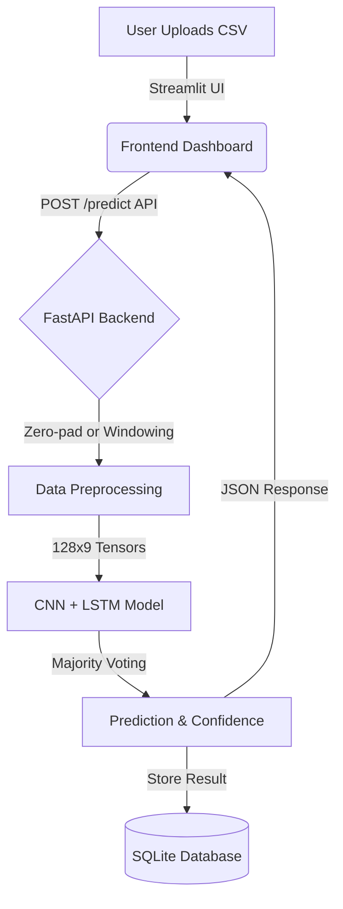
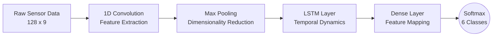
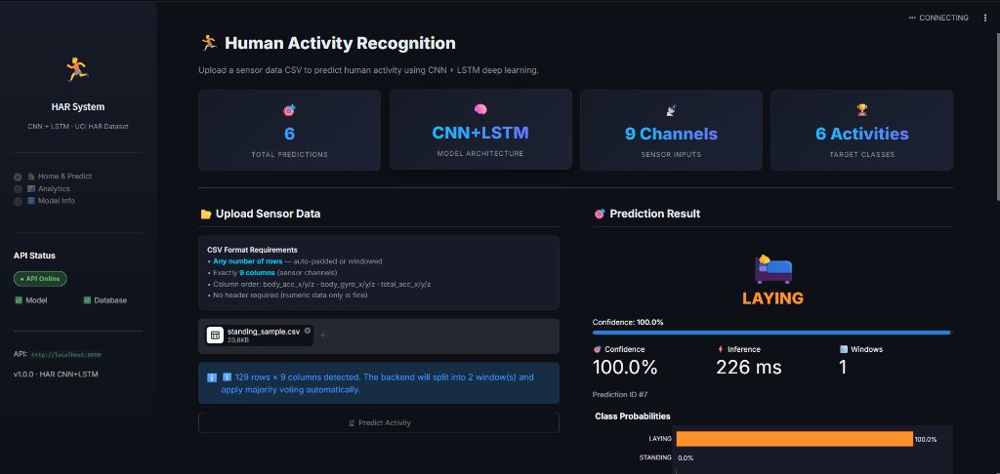
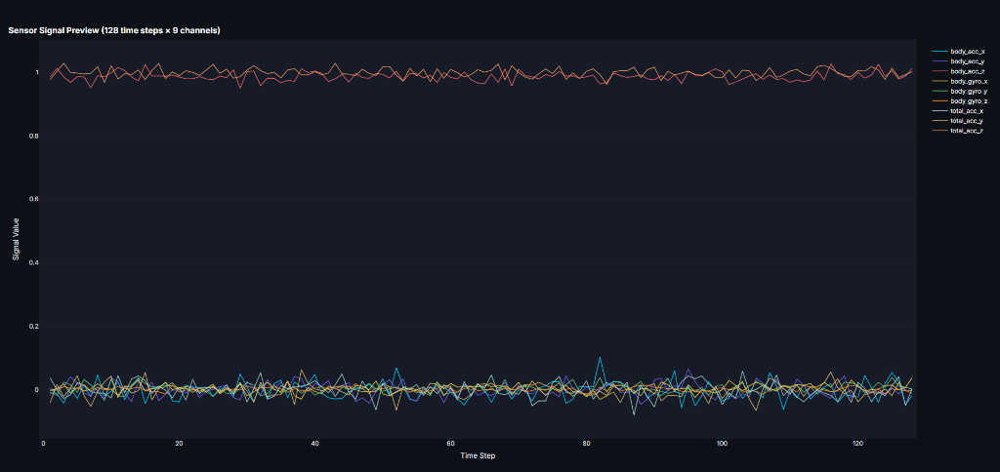
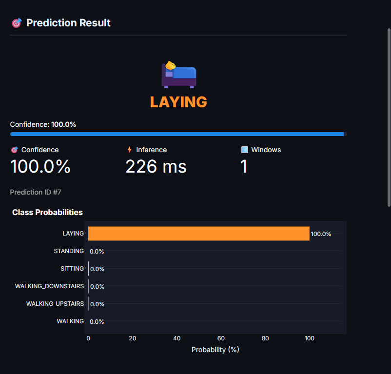
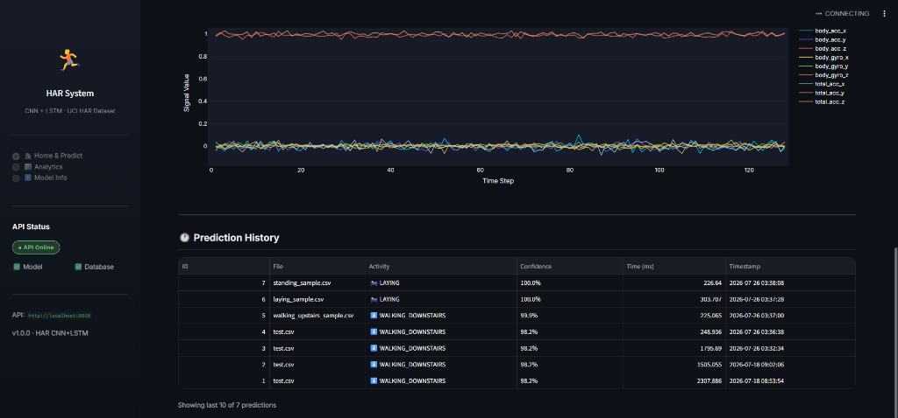

# Human-Activity-Recognition-System


> **Predicting Human Activities from Smartphone Sensor Data using Deep Learning**

An end-to-end Machine Learning project that classifies human physical activities (Walking, Sitting, Standing, Laying, etc.) using raw inertial sensor data. The system features a custom 1D CNN + LSTM neural network, a high-performance FastAPI backend, and an interactive Streamlit dashboard.

---

## 📖 Table of Contents
- [Project Description](#-project-description)
- [Features](#-features)
- [System Architecture](#-system-architecture)
- [Project Workflow](#-project-workflow)
- [Deep Learning Model](#-deep-learning-model)
- [Dataset Information](#-dataset-information)
- [Technology Stack](#-technology-stack)
- [Folder Structure](#-folder-structure)
- [Installation Guide](#-installation-guide)
- [API Documentation](#-api-documentation)
- [Screenshots](#-screenshots)
- [Future Improvements](#-future-improvements)
- [Challenges & Learning Outcomes](#-challenges--learning-outcomes)
- [License](#-license)
- [Author](#-author)

---

## 🚀 Project Description

**Human Activity Recognition (HAR)** is the process of identifying a person's specific physical activity based on sensor data. 

This project solves the problem of automated activity tracking by taking raw accelerometer and gyroscope readings from a smartphone and passing them through a deep learning pipeline to predict the user's current posture or movement. 

**Why CNN + LSTM?**
- **CNN (Convolutional Neural Network):** Automatically acts as a feature extractor, identifying spatial patterns and distinct signatures (like the impact of a footstep) in the raw signal.
- **LSTM (Long Short-Term Memory):** Captures the temporal dependencies of those extracted features over time, understanding how a sequence of physical movements strings together into a continuous activity.

**Why FastAPI, Streamlit, and SQLite?**
- **FastAPI:** Provides a lightning-fast, asynchronous REST API for serving the model with built-in data validation (Pydantic).
- **Streamlit:** Allows for the rapid development of a beautiful, interactive, and data-focused frontend dashboard without writing complex frontend code.
- **SQLite:** A lightweight, serverless database perfectly suited for storing prediction history and analytics locally without complex setup.

---

## ✨ Features
- ✔ **CNN + LSTM Model:** High-accuracy deep learning architecture.
- ✔ **Human Activity Prediction:** Classifies 6 distinct physical activities.
- ✔ **FastAPI Backend:** Robust API serving predictions and analytics.
- ✔ **Streamlit Dashboard:** Dark-mode, interactive UI for end-users.
- ✔ **SQLite Database:** Persistent storage of all prediction histories.
- ✔ **CSV Upload:** Users can upload raw sensor data for instant inference.
- ✔ **Automatic CSV Validation:** Validates columns and data types automatically.
- ✔ **Variable-Length CSV Support:** Accepts any duration of sensor data.
- ✔ **Dynamic Window Processing:** Automatically splits long sequences into 128-step windows and applies majority voting.
- ✔ **Prediction History:** Browse past predictions and their confidence scores.
- ✔ **Analytics Dashboard:** Visual breakdowns of class distributions and model performance.
- ✔ **Interactive Charts:** Plotly-powered visualizations of raw sensor signals and class probabilities.
- ✔ **Swagger Documentation:** Auto-generated interactive API docs.

---

## 🏛️ System Architecture



---

## 🔄 Project Workflow

```text
User Uploads CSV
       ↓
Streamlit Frontend
       ↓
FastAPI Backend (POST /predict)
       ↓
Data Preprocessing (Padding/Windowing)
       ↓
CNN + LSTM Model Inference
       ↓
Majority Vote Prediction & Confidence Score
       ↓
SQLite Database (Save Record)
       ↓
Dashboard (Display Results & Charts)
```

---

## 🧠 Deep Learning Model

The core of this system is a hybrid neural network designed for time-series sensor data.

- **1D CNN Layers:** Slide across the time steps to extract high-level spatial features from the 9 raw signal channels.
- **LSTM Layers:** Process the sequences of features extracted by the CNN to learn the temporal dynamics of the activity.
- **Dense Layers:** Map the learned representations to the 6 target activity classes using a Softmax activation.

*(Insert Model Architecture Flowchart Placeholder here)*


---

## 📊 Dataset Information

This project utilizes the **UCI HAR Dataset**, a benchmark dataset for activity recognition.

- **Subjects:** 30 Volunteers (aged 19-48 years).
- **Device:** Samsung Galaxy S II (waist-mounted).
- **Sensors Used:** 3-axial Accelerometer and 3-axial Gyroscope (captured at 50Hz).
- **Input Shape:** `(128 time steps, 9 channels)`. Every prediction represents a 2.56-second window of movement.
- **9 Sensor Signals:**
  - `body_acc_x`, `body_acc_y`, `body_acc_z`
  - `body_gyro_x`, `body_gyro_y`, `body_gyro_z`
  - `total_acc_x`, `total_acc_y`, `total_acc_z`

### 6 Target Activities:
1. WALKING
2. WALKING_UPSTAIRS
3. WALKING_DOWNSTAIRS
4. SITTING
5. STANDING
6. LAYING

---

## 🛠️ Technology Stack

| Category | Technology |
|---|---|
| **Programming Language** | Python 3.9+ |
| **Deep Learning** | TensorFlow, Keras |
| **Backend API** | FastAPI, Uvicorn |
| **Frontend UI** | Streamlit |
| **Database** | SQLite, SQLAlchemy |
| **Data Manipulation** | NumPy, Pandas |
| **Data Visualization** | Plotly |
| **Model Serialization** | Joblib |

---

## 📂 Folder Structure

```text
Human-Activity-Recognition-System/
├── backend/                  # FastAPI Application
│   ├── main.py               # API Entry point
│   ├── routes.py             # API Endpoints
│   ├── services.py           # Business logic & Inference
│   ├── schemas.py            # Pydantic models
│   ├── models.py             # SQLAlchemy ORM models
│   └── database.py           # DB Connection
├── frontend/                 # Streamlit Dashboard
│   └── app.py                # Main UI application
├── model/                    # ML Pipeline
│   ├── cnn_lstm.py           # Model architecture definition
│   ├── train.py              # Training script
│   ├── predict.py            # Inference script
│   ├── dataset.py            # Data loading utilities
│   └── utils.py              # Helper functions
├── data/                     # Raw UCI HAR Dataset (Ignored by Git)
├── saved_models/             # Trained models & scalers
├── dummy_data/               # Sample CSVs for testing
├── .env.example              # Environment variables template
├── requirements.txt          # Python dependencies
└── README.md                 # Project documentation
```

---

## ⚙️ Installation Guide

Follow these steps to run the project locally on your machine.

### 1. Clone the repository
```bash
git clone https://github.com/mandarm03/Human-Activity-Recognition-System.git
cd Human-Activity-Recognition-System
```

### 2. Create and activate a Virtual Environment
```bash
# Windows
python -m venv venv
venv\Scripts\activate

# Linux / Mac
python3 -m venv venv
source venv/bin/activate
```

### 3. Install Requirements
```bash
pip install -r requirements.txt
```

### 4. Train the Model (If not using pre-trained weights)
Ensure the UCI HAR dataset is in the `data/` folder, then run:
```bash
python model/train.py
```

### 5. Run the FastAPI Backend
```bash
uvicorn backend.main:app --reload --port 8000
```
*The API will be available at `http://localhost:8000`*

### 6. Run the Streamlit Frontend
Open a new terminal, activate the virtual environment, and run:
```bash
streamlit run frontend/app.py
```
*The Dashboard will be available at `http://localhost:8501`*

---

## 🌐 API Documentation

The FastAPI backend automatically generates interactive Swagger documentation available at `http://localhost:8000/docs`.

### Key Endpoints:

#### `POST /predict`
Upload a CSV file of sensor data to get an activity prediction.
- **Request:** `multipart/form-data` containing a CSV file.
- **Response Example:**
  ```json
  {
    "id": 1,
    "filename": "walking_sample.csv",
    "predicted_activity": "WALKING",
    "confidence": 0.985,
    "probabilities": { ... },
    "preprocessing_note": "Input is exactly 128 rows — no adjustment needed."
  }
  ```

#### `GET /history`
Retrieve a paginated history of past predictions.

#### `GET /health`
Check the status of the API, Model, and Database.

#### `GET /model-info`
Retrieve details about the underlying CNN+LSTM model architecture.

---

## 📸 Screenshots

- **Dashboard / Upload Page:** 
  

- **Interactive Sensor Data Chart:** 
  

- **Prediction Result & Confidence:** 
  

- **Analytics & History Page:** 
  

- **Swagger API Docs:** 
  *(To be added)*

*(To create a GIF demo, record your screen using a tool like OBS or LICEcap while uploading a CSV and viewing the prediction result, then place the GIF in this section).*

---

## 🔮 Future Improvements
While the current system is fully functional, future enhancements could include:
- **Real-time mobile prediction:** Integrating the model directly into a mobile application.
- **Bluetooth wearable integration:** Connecting directly to smartwatches for live inference.
- **Live streaming:** Creating a WebSocket endpoint in FastAPI to accept live sensor streams.
- **Transformer models:** Experimenting with Time-Series Transformers instead of LSTMs.
- **Cloud database:** Migrating from SQLite to PostgreSQL for distributed deployments.

---

## 🧗 Challenges Faced & Learning Outcomes
- **Handling Variable-Length Data:** A major challenge was dealing with CSV uploads of varying lengths. This was solved by implementing a robust preprocessing pipeline in the backend that intelligently pads short sequences and applies majority-voting to overlapping windows for long sequences.
- **API Architecture:** Learned how to separate business logic from route controllers in FastAPI, ensuring the API remains fast, scalable, and easy to maintain.
- **Time-Series Deep Learning:** Gained deep practical experience in combining Convolutions (spatial feature extraction) with Recurrent layers (temporal sequence learning) for complex sensor data.


## 👨‍💻 Author

**Mandar Merukar**

*Feel free to star ⭐ this repository if you found it helpful!*
